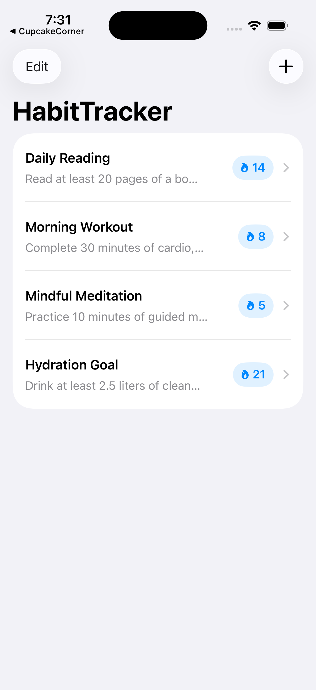
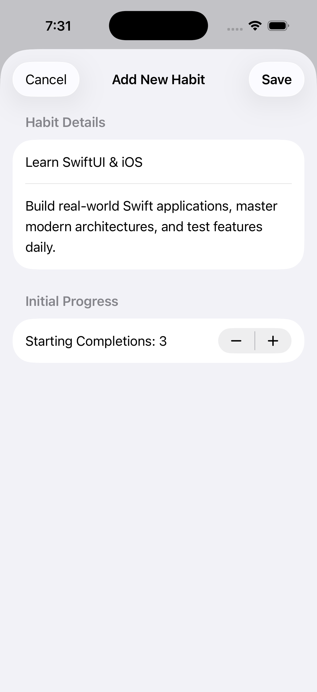
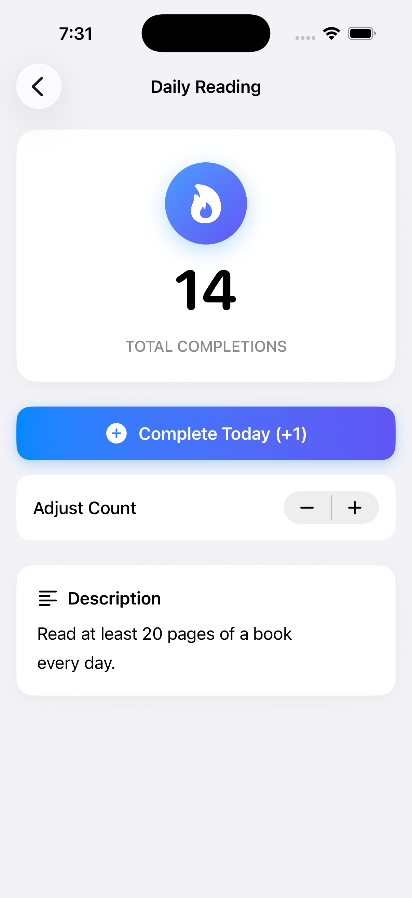

# HabitTracker 📱

[](https://developer.apple.com/ios/)
[](https://swift.org/)
[](https://developer.apple.com/xcode/swiftui/)

An intuitive, beautifully crafted habit-tracking iOS application built with modern **SwiftUI** and Swift's **Observation** framework.

---

## 📖 Project Overview

**HabitTracker** was developed as the milestone challenge for **Days 47 (Milestone Challenge for Projects 7–9: iExpense, Moonshot, and Navigation)** in Paul Hudson's **[100 Days of SwiftUI](https://www.hackingwithswift.com/100/swiftui/47)** curriculum.

The goal of this milestone project is to synthesize core concepts from Projects 7 through 9:
- Building complex multi-screen navigation workflows with `NavigationStack`.
- Sharing and updating reactive data models across multiple views using Swift's `@Observable` macro.
- Presenting modal sheets to collect and validate user input.
- Seamlessly saving and loading state from `UserDefaults` with `Codable`.
- Providing direct manipulation controls (completion incrementing, swipe-to-delete).

---

## 📱 App Previews

<p align="center">
  
  &nbsp;&nbsp;&nbsp;&nbsp;
  
  &nbsp;&nbsp;&nbsp;&nbsp;
  
</p>

<p align="center">
  <em>Home Habit List &bull; Add New Habit Sheet &bull; Interactive Completion Detail</em>
</p>

---

## ✨ Features

- **Reactive State Management**: Built using Swift's modern `@Observable` macro (iOS 17+) for zero-boilerplate, highly efficient reactive UI updates across all views.
- **UserDefaults & Codable Persistence**: Automatically encodes and decodes habit data to and from JSON in `UserDefaults` via `didSet` observers, preserving all habits and streaks between launches.
- **Interactive Completion Tracking**: Dedicated detail screen allowing users to increment completion streaks with a high-impact **"Complete Today (+1)"** action button or fine-tune counts with a `Stepper`.
- **Sheet Presentations & Input Validation**: Modal sheets using `@Environment(\.dismiss)` for adding new activities with input validation (preventing empty titles) and customizable initial counts.
- **Swipe-to-Delete & Empty State**: Native list interaction allowing users to remove habits via swipe, complete with fallback `ContentUnavailableView` when no habits exist.
- **Modern iOS 17 Design System**: Polished aesthetic with custom gradients, SF Symbols, dynamic type, and rounded badge capsules.

---

## 🏗️ Architecture & Code Structure

The project adopts a clean, modular structure following SwiftUI best practices:

```
HabitTracker/
├── HabitTrackerApp.swift       # Application entry point (@main)
├── Activity.swift              # Core model (Identifiable, Codable, Equatable, Hashable)
├── Activities.swift            # Observable state container & UserDefaults persistence
├── ContentView.swift           # Main list navigation stack & row components
├── AddActivityView.swift       # Sheet modal for creating habits with validation
├── ActivityDetailView.swift    # Detail screen with completion streak action buttons
└── screenshots/                # High-resolution Retina simulator screenshots
```

### Component Breakdown

| Component | Responsibility |
| :--- | :--- |
| **`Activity`** | Data model representing a single habit (UUID, title, description, and completion count). |
| **`Activities`** | Observable class managing the `items` array and synchronizing with `UserDefaults` (`HabitTracker.Activities`). |
| **`ContentView`** | Root navigation interface displaying the list of habits, empty states, and add sheet triggers. |
| **`AddActivityView`** | Form allowing users to input habit title, description, and initial completion count. |
| **`ActivityDetailView`** | Visual presentation of habit metrics, providing direct actions to increment and adjust counts. |
| **`HabitTrackerApp`** | Initializes the root observable model and injects it into the SwiftUI window hierarchy. |

---

## 🛠️ How to Build and Run

### Prerequisites
- **macOS Sonoma (14.0)** or later
- **Xcode 15.0+** (Swift 5.9+)
- **iOS 17.0+ Simulator** (or physical iOS device)

### Using Xcode
1. Clone this repository:
   ```bash
   git clone https://github.com/SELVAGANESH7378/HabitTracker.git
   cd HabitTracker
   ```
2. Open `HabitTracker.xcodeproj` in Xcode:
   ```bash
   open HabitTracker.xcodeproj
   ```
3. Select an iOS 17+ Simulator (e.g., iPhone 17 Pro) from the target device menu.
4. Press **`Cmd + R`** or click **Product > Run** to build and launch the application.

### Using Command Line (`xcodebuild`)
```bash
DEVELOPER_DIR=/Applications/Xcode.app/Contents/Developer xcodebuild \
  -project HabitTracker.xcodeproj \
  -scheme HabitTracker \
  -destination 'platform=iOS Simulator,name=iPhone 17 Pro' \
  build
```
